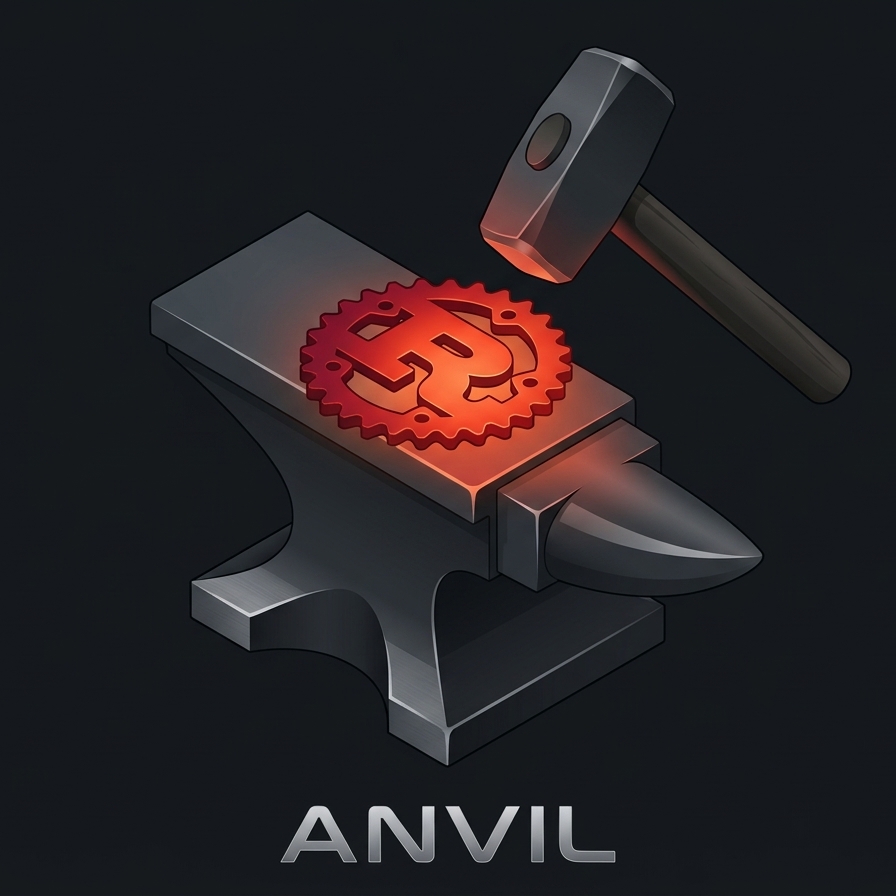

<div align="center">
  
  <h1>Anvil</h1>
  <p><strong>A native UI runtime built around a canonical Deque Tree.</strong></p>
  <p>Rust · JavaScript · CSS · WGPU · Winit</p>
</div>

---

Anvil is an experimental native UI runtime exploring how to bring familiar web technologies into a native application environment without embedding Chromium, a WebView, or a browser DOM.

Its central idea is a single canonical UI hierarchy backed by a fixed-topology binary tree of Deques. JavaScript commands and framework commits update that hierarchy incrementally, while rendering and style calculation consume derived indexes and targeted mutation information.

> **Project status:** early-stage and actively evolving. The core data structures, JavaScript bridge, CSS integration, framework-commit boundary, and native rendering interfaces are under development. Anvil is not yet a drop-in browser replacement or a production-ready web framework runtime. Public APIs and supported CSS behavior may change.

## Goals

- **Native by design:** use native windowing and rendering infrastructure rather than Chromium or WebView.
- **One source of truth:** the Deque Tree owns the actual UI elements. Framework adapters keep identifier mappings, not a second UI tree.
- **Incremental updates:** after the initial snapshot, structural and property changes are represented as targeted mutations and commits.
- **Predictable rendering work:** maintain render order and change information so ordinary updates do not require repeatedly discovering the entire UI hierarchy.
- **Web technologies, native execution:** embed a JavaScript engine and a CSS style engine while keeping the host runtime native.

## Current components

| Component | Role |
| --- | --- |
| `deque_tree` | Canonical Deque Tree, subtree-span structure, stable node identities, registry, and parent-first render order. |
| `runtime::ui` | UI elements, initial snapshots, structural mutations, and the non-owning logical projection. |
| `runtime::bridge` | JavaScript-facing `Anvil` commands for creating and updating UI elements. |
| `runtime::ecmascript` | JavaScript execution powered by Boa. |
| `runtime::framework` | Initial-snapshot and incremental-commit interfaces for framework integrations. |
| `runtime::stylo` | CSS selector matching and style computation powered by Stylo. |
| `runtime::renderer` | Native renderer interface, render-frame dispatch, and WGPU context. |
| `runtime::window` | Native window and event-loop host powered by Winit. |
| `runtime::text` | Text and font-system integration powered by cosmic-text. |

These are the current building blocks, not a claim that every browser feature or framework adapter is already implemented.

## Architecture

See [ARCHITECTURE.md](docs/ARCHITECTURE.md) for the normative ownership rules, subsystem boundaries, incremental invalidation model, Layout contract, and reconstruction sequence.


### Canonical hierarchy

The Deque Tree is the sole owner of UI elements. Each Deque stores an ordered sequence of entries and parallel subtree-span metadata. Structural relationships are derived from those spans and the Deque Tree topology rather than from a duplicated `children` list on every element.

The tree's topology is established during initial construction and then sealed. Runtime changes operate within that topology by inserting, removing, and moving element subtrees between existing Deques. Empty Deques can remain as ghost nodes so the topology and its derived traversal order stay stable.

### Incremental updates

An initial snapshot establishes the UI model. After that, mutations are journaled and associated with the Deques they affect. The registry uses targeted identity-hash checks and pending render changes, while style invalidation uses mutation information instead of unconditionally walking the full projection.

Stylesheet-wide recalculation is scheduled in bounded batches over the existing render order. This spreads the work across frames; it does not make a stylesheet change computationally free.

### Native rendering and styling

Anvil exposes a native renderer boundary and a WGPU context. The CSS engine is based on Stylo and operates through an adapter over the logical projection. The JavaScript runtime is powered by Boa, and native window management uses Winit.

Anvil does not currently provide the complete browser platform: browser DOM APIs, full web compatibility, and all CSS features are not implied by the presence of JavaScript and CSS engines.

## Quick start

### Requirements

- Rust toolchain compatible with the `rust-version` declared in `Cargo.toml`.
- A working native graphics environment and the platform dependencies required by Winit and WGPU.

### Build and test

```bash
cargo check
cargo test
```

### Evaluate JavaScript

The host runtime installs the global `Anvil` command object. The following example creates a root Deque and an element in it:

```rust
use anvil::HostRuntime;

fn main() -> Result<(), Box<dyn std::error::Error>> {
    let mut runtime = HostRuntime::new();

    runtime.evaluate(
        r#"
        const root = Anvil.createRootDeque();
        const app = Anvil.createElement(root, "main", "back");
        Anvil.setProperty(app, "id", "app");
        Anvil.setStyle(app, "display", "block");
        "#,
    )?;

    Ok(())
}
```

The bridge currently exposes these commands:

- `Anvil.createRootDeque()`
- `Anvil.createChildDeque(parent, side)` where `side` is `"left"` or `"right"`
- `Anvil.createElement(deque, tag, end)`
- `Anvil.createText(deque, text, end)`
- `Anvil.setText(element, text)`
- `Anvil.setProperty(element, name, value)`
- `Anvil.setStyle(element, name, value)`
- `Anvil.removeSubtree(element)`
- `Anvil.moveSubtree(element, targetDeque, end)`

For `end`, use `"front"` or `"back"`. Handles returned by creation commands can be passed to subsequent commands in the same JavaScript evaluation.

## Framework integration

The framework boundary is designed around a one-time initial snapshot followed by incremental commits. `InitialSnapshotSource` provides the initial Deque groups, and `FrameworkAdapter` applies subsequent operations using stable framework IDs mapped to native handles.

This is an integration interface, not a statement that React, Vue, Svelte, or other framework adapters are already included in this repository.

## Performance benchmarks

See BENCHMARKS.md for the local performance and memory baselines, methodology, and commands for running the benchmark harnesses.

## License

Anvil is distributed under the **GNU General Public License v3.0 only (GPL-3.0-only)**. See [`LICENSE`](LICENSE) for the complete license text.
